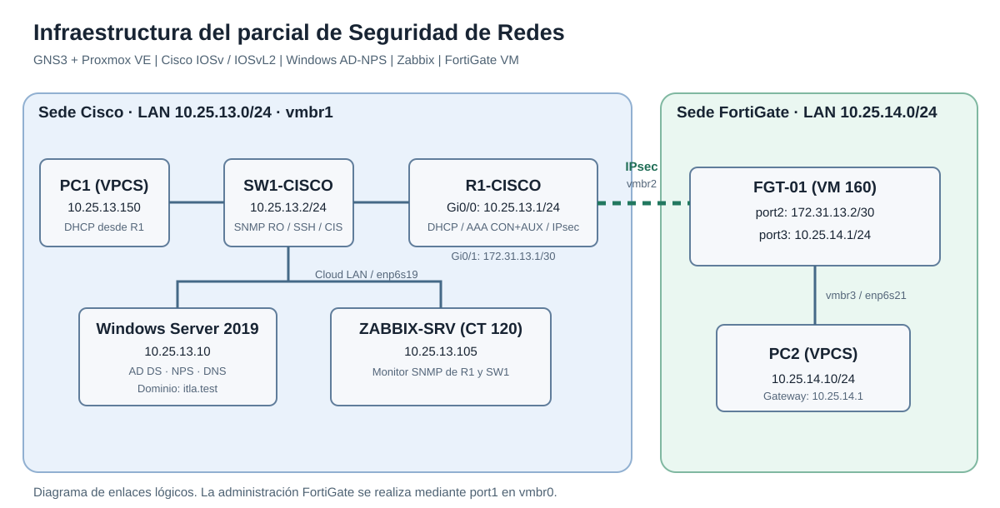

<!-- DEMOSTRACIÓN: insertar aquí la URL de YouTube al publicarla -->
**Video demostrativo (YouTube):** pendiente de publicación.

**[Topología](diagramas/topologia.svg)** · **[Verificaciones](documentacion/verificaciones.md)** · **[Guion del video](documentacion/guion-video.md)**

---

# Parcial de Seguridad de Redes — Cisco, NPS, Zabbix y FortiGate

**Estudiante:** Elian Sterling Severino Mejía · **Matrícula:** 2025-1331  
**Fecha del laboratorio:** 10 de noviembre de 2026

## Propósito y topología

Implementar una infraestructura de seguridad de redes en Proxmox y GNS3, con DHCP, monitoreo SNMP, autenticación y autorización AAA, endurecimiento de un switch Cisco, SSH administrativo y VPN IPsec entre Cisco y FortiGate.

| Equipo | Plataforma y rol | Direccionamiento |
| --- | --- | --- |
| R1-CISCO | IOSv; gateway LAN, DHCP, AAA y VPN | Gi0/0: `10.25.13.1/24`; Gi0/1: `172.31.13.1/30` |
| SW1-CISCO | IOSvL2; switching, SSH y SNMP | `10.25.13.2/24` |
| PC1 | VPCS, cliente DHCP | `10.25.13.150/24` |
| SRV-AD-NPS | Windows Server 2019, AD DS, DNS, NPS | `10.25.13.10/24` |
| ZABBIX-SRV | CT 120, Debian y Zabbix 7.0 | `10.25.13.105/24` durante las pruebas |
| FGT-01 | FortiOS 7.0.3, VM 160, IPsec | port2: `172.31.13.2/30`; port3: `10.25.14.1/24` |
| PC2 | VPCS, LAN del FortiGate | `10.25.14.10/24` |

**Proxmox:** `vmbr1` conecta la LAN Cisco, Windows y Zabbix; `vmbr2` conecta la WAN Cisco–FortiGate; `vmbr3` conecta la LAN FortiGate con PC2. `vmbr0` se utiliza para administración de los servicios.  
**Dominio Active Directory:** `itla.test`.

## SNMP y Zabbix

Se configuró SNMPv2c de solo lectura en R1 y SW1, con la ACL `ZABBIX-SNMP-ACL` que restringe consultas a Zabbix. Se obtuvo una respuesta `sysDescr.0` mediante `snmpwalk` de ambos Cisco. Los dos equipos se registraron en Zabbix con la plantilla `Cisco IOS by SNMP`, y se confirmó su indicador SNMP verde.

## AAA en consola y auxiliar

Windows Server hospeda AD DS y NPS. En Active Directory se creó la OU `ITLA-Network-Admins`, el grupo `GG-CISCO-ADMINS` y el usuario `cisco.admin`.

La política de NPS `CISCO-AAA-ADMINS` concede acceso al grupo de administradores y devuelve `Service-Type=Administrative` y el atributo Cisco `shell:priv-lvl=15`. El router se registra en NPS como cliente RADIUS en `10.25.13.1`.

La prueba RADIUS devolvió `User successfully authenticated` con privilegio 15. Las líneas `console 0` y `aux 0` tienen autenticación y autorización `CON-AUX`, mientras que SSH utiliza autenticación local. Se demostró el ingreso real de `cisco.admin` por consola con privilegio 15 y una sesión SSH local independiente de `admin1331`. La línea AUX está configurada; su ingreso por un puerto auxiliar no se ha documentado con prueba independiente.

## DHCP y conectividad

R1 suministra direcciones DHCP en `10.25.13.0/24`. La PC1 recibió `10.25.13.150/24`, gateway `10.25.13.1` y DNS `10.25.13.10` / `8.8.8.8`. Se comprobó conectividad desde PC1 con R1 y SW1.

## Hardening del switch

Se implementaron controles asociados a buenas prácticas de endurecimiento Cisco IOS y CIS. Los identificadores exactos deben contrastarse con la edición del CIS Benchmark utilizada.

| Control | Implementación y verificación |
| --- | --- |
| SSHv2 con RSA de 2048 bits | `show ip ssh` y acceso SSH exitoso |
| Deshabilitar Telnet administrativo | `transport input ssh`, conexión al puerto TCP 23 rechazada |
| Deshabilitar administración HTTP/HTTPS | `no ip http server`; `no ip http secure-server` |
| Deshabilitar IP source routing | `no ip source-route` |
| Caducidad de sesiones VTY | `exec-timeout 5 0` |
| SNMP de solo lectura con ACL | Consultas `snmpwalk` desde Zabbix |

Se identificaron tres puertos conectados (Gi0/0 a Gi0/2) y otros sin conexión. La deshabilitación de los puertos no utilizados deberá respaldarse con una salida definitiva de `show interfaces status` antes de incluirla como control verificado.

## VPN Cisco–FortiGate

Se configuró una VPN IPsec sitio a sitio entre `172.31.13.1` y `172.31.13.2`, que protege el tráfico entre `10.25.13.0/24` y `10.25.14.0/24`. R1 mostró estado IKEv1 `QM_IDLE` y asociaciones IPsec con **4 paquetes cifrados y 4 descifrados**, y cero errores. PC1 recibió respuestas ICMP de PC2 a través del túnel. Se efectuó una prueba adicional desactivando temporalmente la VPN desde la GUI de FortiGate y restaurándola después.

La edición de evaluación de FortiGate restringe el cifrado a algoritmos heredados; la propuesta DES/SHA1/DH2 se usa únicamente en el laboratorio y no es segura para producción.

## Acceso administrativo por SSH

R1 y SW1 admiten acceso SSHv2 con un usuario local `admin1331`. Se comprobaron sesiones administrativas desde Zabbix y el rechazo de conexiones TCP al puerto 23 en ambos equipos.

## Archivos y demostraciones

La documentación de pruebas y los comandos utilizados están en [documentacion/verificaciones.md](documentacion/verificaciones.md). Los archivos exportados de configuración deben incorporarse de forma individual para R1-CISCO, SW1-CISCO y FGT-01. Antes de publicarlos se deben retirar las contraseñas, claves compartidas RADIUS e IPsec y cualquier secreto.

Las capturas originales se deben guardar en `evidencias/` e insertar en esta página con enlaces Markdown de imagen. El video demostrativo deberá subirse exclusivamente a YouTube, durar como máximo 10 minutos y tener su enlace al principio de este README antes de la entrega.
